# Iki on a Mac: Beginner's Guide

By the end of this guide the Iki shakuhachi instrument will be running on your Mac, built from its source code with one command: `cargo run`. You don't need any computer experience. Just follow the parts in order.

## Before you start

You need a Mac, an internet connection, about 1 hour, and roughly 5 GB of free disk space. You will type (or paste) a handful of commands; this guide gives you every one of them.

**What you need**

- A Mac running a recent macOS (macOS 26 "Tahoe" is perfect).
- Your Mac's login password. The Terminal will ask for it once or twice.
- A free GitHub account (Part 3 shows how to make one).
- An invitation to the Iki project from its owner. The project is private, so the owner has to add your GitHub username first.

**How to read this guide**

- Grey boxes like `this` are commands. Copy them exactly, paste them into the Terminal, and press the **Return** key (the big key labelled ↩ or "return").
- To copy: select the text and press **⌘ Command + C**. To paste into the Terminal: click the Terminal window, then press **⌘ Command + V**.
- ⌘ is the **Command** key, right next to the space bar.
- When you type your password in the Terminal, **nothing appears on screen, not even dots**. That is normal. Type it anyway and press Return.

**The plan**

1. **Terminal**: the app where you type commands to your Mac.
2. **AI helpers**: if you get stuck anywhere, an AI assistant in the Terminal can read the error and fix it with you.
3. **Git and GitHub**: Git downloads the code; GitHub is the website where the code lives.
4. **Rust**: the programming language Iki is written in, plus its tool `cargo`.
5. **cargo run**: turns the code into a working app and opens it.

## Part 1: Open the Terminal

The Terminal is a window where you type commands instead of clicking. It is already on every Mac; you never need to install it.

### 1.1 Open the Terminal (the quick way)

1. Hold down the **⌘ Command** key and tap the **Space** bar. A search bar (called *Spotlight*) appears in the middle of the screen.
2. Type `Terminal`.
3. Press **Return**.

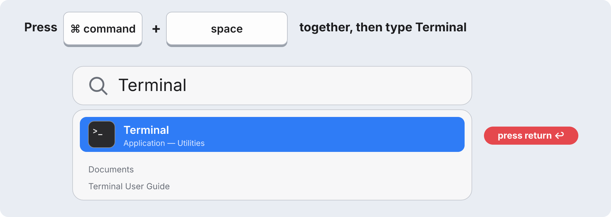

A window with white (or black) background and some text opens. That is the Terminal.

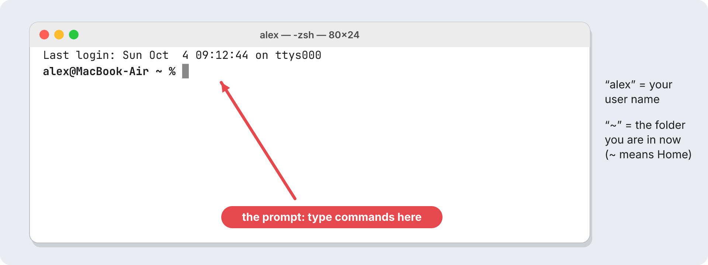

The line ending in `%` is called the **prompt**. It means "I'm ready, type a command." The word before `%` is the folder you are currently *in*. `~` (a squiggle called a tilde) is short for your **Home folder**, the one with your name and a little house icon in Finder.

**Tip: keep the Terminal in the Dock.** While the Terminal is open, right-click its icon in the Dock (the row of apps at the bottom of the screen), choose **Options**, then **Keep in Dock**. Next time, just click it.

Other ways to open it: open **Finder**, click **Applications** in the left sidebar, open the **Utilities** folder, and double-click **Terminal**. Or open **Launchpad** / **Apps** and type Terminal.

### 1.2 Open the Terminal *in a specific folder*

Commands usually act on the folder you are *in*. So for this project, the Terminal must be "inside" the `iki` folder. There are three easy ways. Use whichever you like; they all do the same thing.

**Way A: Right-click the folder in Finder (easiest)**

1. Open **Finder** (the blue smiley face in the Dock).
2. Find the folder, for example `iki` in your Home folder.
3. **Right-click** it. On a trackpad: click with **two fingers**, or hold **Control** and click.
4. Move down to **Services** at the bottom of the menu.
5. Click **New Terminal at Folder**.

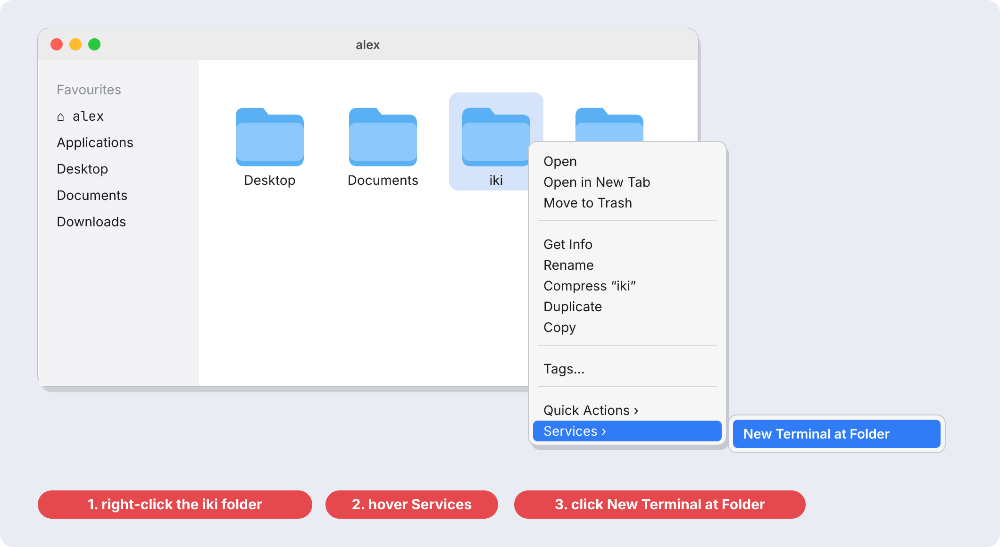

A Terminal window opens and the prompt shows the folder name, like `alex@MacBook-Air iki %`.

If you don't see **New Terminal at Folder**: open **System Settings** → **Keyboard** → **Keyboard Shortcuts…** → **Services** → **Files and Folders**, and tick **New Terminal at Folder**. Click **Done**, then try again.

**Way B: Type `cd` and drag the folder in**

1. Open the Terminal (section 1.1).
2. Type `cd` followed by **one space**. Do **not** press Return yet.
3. Drag the folder from a Finder window and drop it onto the Terminal window. Its full address appears after `cd `.
4. Now press **Return**.

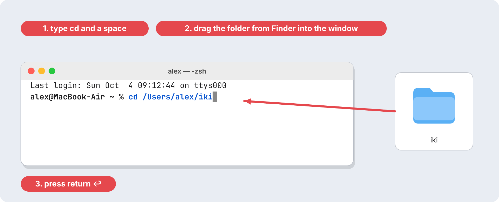

`cd` means **c**hange **d**irectory. "Directory" is just the techie word for folder.

**Way C: Type the path yourself**

Once the project exists (after Part 3), this one command always takes you there:

```bash
cd ~/iki
```

### 1.3 Three commands to feel at home

| Command | What it does | Example |
| --- | --- | --- |
| `pwd` | Shows which folder you are in (**p**rint **w**orking **d**irectory) | prints `/Users/alex/iki` |
| `ls` | Lists the files in this folder | shows `Cargo.toml  README.md  crates …` |
| `open .` | Opens the current folder in Finder (note the dot) | a Finder window pops up |

**Golden rules of the Terminal**

- One command per line. Press **Return** to run it.
- Wait until the `%` prompt comes back before typing the next command.
- To **stop** a running command, press **Control + C** (Control, not Command).
- Press the **↑ Up arrow** to bring back the last command, so you don't retype it.
- If a command needs your password, type your Mac login password. **No characters show while typing.** Press Return.
- To close the Terminal: **⌘ Command + Q**.

## Part 2: Stuck? Ask an AI helper

If you get stuck at any step in Parts 3 to 5, an AI coding assistant in the Terminal can help. It reads the error, explains it in plain words, and can run the fixing commands for you. You only need **one** of the three below; set it up now so it's ready when you need it.

| Tool | Made by | Command | Account needed |
| --- | --- | --- | --- |
| Claude Code | Anthropic | `claude` | Claude Pro or Max plan (the free plan doesn't include it) |
| Grok Build | xAI | `grok` | xAI / Grok account |
| Antigravity CLI | Google | `agy` | Google account |

**Where to start it.** An AI helper works on the folder the Terminal is in (Part 1.2). Before you have downloaded Iki, just start it in your Home folder. Once the `iki` folder exists (Part 3), always start it with `cd ~/iki` first.

Until you've finished Part 3, leave out the `cd ~/iki` line in the examples below and just type the tool's name (`claude`, `grok` or `agy`).

**How to ask for help.** Copy the whole error from the Terminal (select it, ⌘C), start the helper, paste it (⌘V) and add a sentence, for example:

- `I'm following a guide to build the Iki project on my Mac. I got this error, please fix it: <paste>`
- `Build and run this project for me.`
- `Explain what this project does, in simple words.`

**Safety.** These helpers can change files and run commands. They ask before doing anything risky: read the question and say yes only if it makes sense.

### 2a. Claude Code

Install it (once):

```bash
curl -fsSL https://claude.ai/install.sh | bash
```

When it finishes, **quit the Terminal (⌘Q) and open it again**. Then start it in the project folder:

```bash
cd ~/iki
claude
```

The first time: pick a colour theme with the arrow keys and press Return, choose to log in with your **Claude account**, log in on the web page that opens, then go back to the Terminal. When asked whether you trust the files in this folder, choose **Yes, proceed**. Now type your question and press Return.

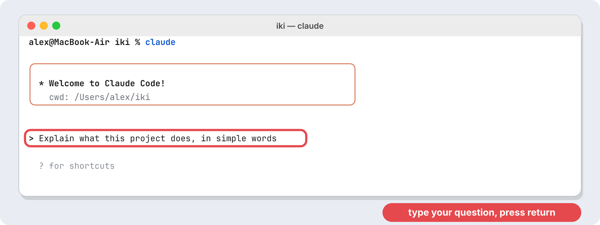

To leave, type `/exit` and press Return.

### 2b. Grok Build

Install it (once):

```bash
curl -fsSL https://x.ai/cli/install.sh | bash
```

Quit the Terminal (⌘Q) and open it again. Then:

```bash
cd ~/iki
grok
```

The first time, it opens your web browser so you can sign in with your xAI / Grok account. Sign in, then come back to the Terminal and type your request, for example `Explain this repo.`

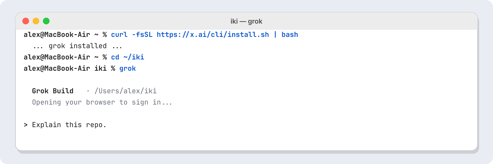

### 2c. Antigravity CLI (agy)

Install it (once):

```bash
curl -fsSL https://antigravity.google/cli/install.sh | bash
```

Quit the Terminal (⌘Q) and open it again. Then:

```bash
cd ~/iki
agy
```

The first time:

1. Your browser opens: sign in with your Google account, then come back to the Terminal.
2. Pick a colour theme and a display mode with the arrow keys (the default is fine), pressing Return each time.
3. When it asks whether you trust this folder, choose **Yes**.
4. Type your request in the box at the bottom and press Return.

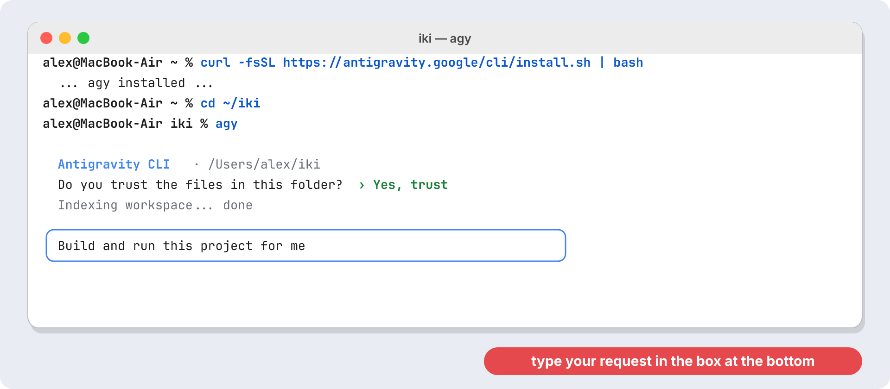

## Part 3: Git, GitHub, and downloading Iki

**Git** is a tool that downloads code and keeps track of changes. **GitHub** (github.com) is the website where the Iki code is stored. "Cloning" means downloading your own copy of a project with Git. Because Iki is private, GitHub must recognise your Mac: you'll do that with an **SSH key**, a pair of matching files that work like a lock and its key. This part takes about 30 minutes, mostly waiting.

### 3.1 Install Apple's Command Line Tools (includes Git)

Apple gives away a small package of developer tools. It contains Git and the tools Rust needs in Part 4, so this one step covers both.

1. Open the Terminal.
2. Paste this and press Return:

```bash
xcode-select --install
```

3. A window pops up. Click **Install** (do **not** click *Get Xcode*; that is a huge app you don't need).
4. Click **Agree** on the licence. The download takes 5 to 20 minutes.
5. When it says *The software was installed*, click **Done**.

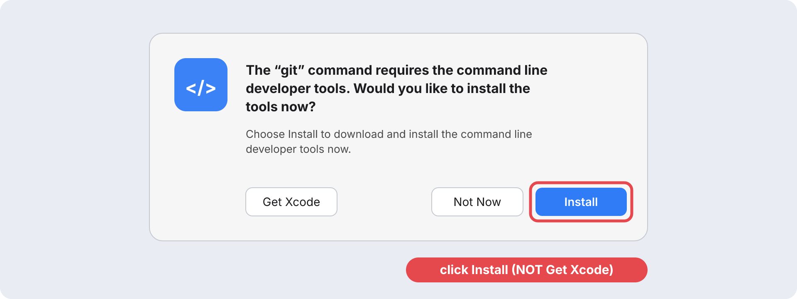

If the Terminal instead says `command line tools are already installed`, great: carry on.

**Check it worked.** Run `git --version`. You should see something like `git version 2.50.1 (Apple Git-155)`. Any version number is fine.

### 3.2 Tell Git your name and email

Run these two lines, with **your** name and email inside the quotes:

```bash
git config --global user.name "Your Name"
git config --global user.email "you@example.com"
```

Nothing is printed when they succeed. That's normal.

### 3.3 Create a GitHub account and get invited

1. Go to **https://github.com/signup** in Safari or Chrome.
2. Enter your email, a password and a **username** (for example `alex-mac`). Solve the puzzle, then type the code GitHub emails you. The **Free** plan is enough.
3. **Send your GitHub username to the Iki owner.** The project is private, so the owner must invite you.
4. You'll get an email titled *…invited you to collaborate on pinting/iki*. Click **View invitation**, then **Accept invitation**.

When you can open **https://github.com/pinting/iki** in your browser and see files, you're in.

### 3.4 Make your SSH key pair

An SSH key comes as two files:

- the **private key** (`id_ed25519`) stays on your Mac. Never send it to anyone.
- the **public key** (`id_ed25519.pub`) is safe to share. You give it to GitHub in the next step.

When GitHub sees the matching private key on your Mac, it knows it's you, so you never type a password.

Run this, using the **same email as your GitHub account**:

```bash
ssh-keygen -t ed25519 -C "you@example.com"
```

It asks three questions. **Press Return three times without typing anything** (this accepts the normal location and uses no extra passphrase).

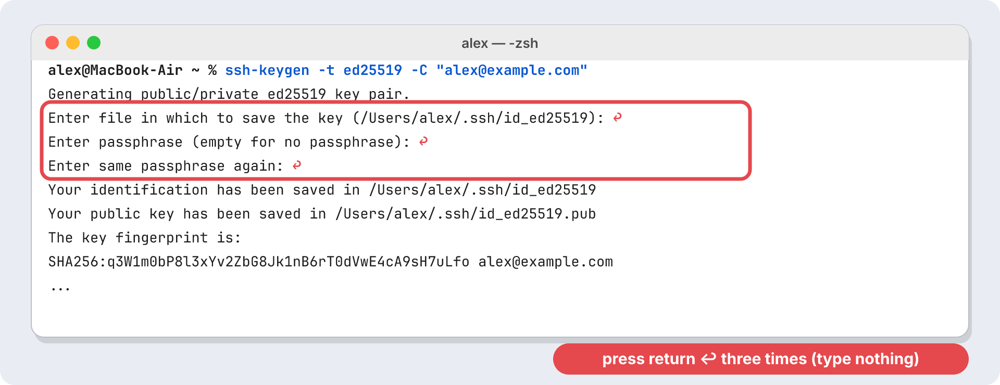

If it says `/Users/…/.ssh/id_ed25519 already exists. Overwrite (y/n)?`, you already have a key: type `n`, press Return, and continue with 3.5.

### 3.5 Give your public key to GitHub

1. Copy the public key with this command (it prints nothing, but the key is now copied, as if you'd pressed ⌘C):

```bash
pbcopy < ~/.ssh/id_ed25519.pub
```

2. In your browser, open **https://github.com/settings/ssh/new**. (Or: click your profile picture at the top right → **Settings** → **SSH and GPG keys** → **New SSH key**.)
3. **Title**: type a name for this computer, for example `My Mac`.
4. **Key type**: leave it on **Authentication Key**.
5. **Key**: click in the big box and paste with **⌘ Command + V**. It starts with `ssh-ed25519`.
6. Click **Add SSH key**. GitHub may ask for your password or a code once more.

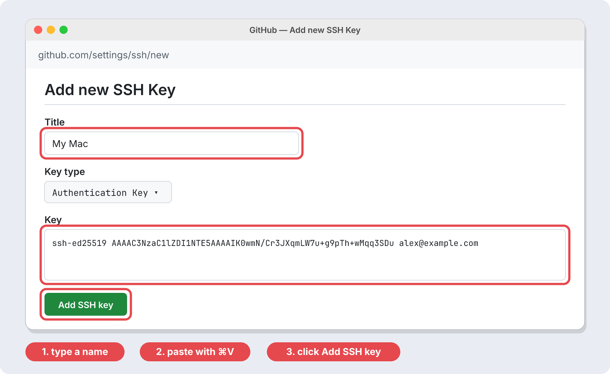

### 3.6 Test the connection

```bash
ssh -T git@github.com
```

The very first time it asks *Are you sure you want to continue connecting (yes/no/[fingerprint])?* Type `yes` (the whole word) and press Return.

Success looks like this: **Hi alex-mac! You've successfully authenticated, but GitHub does not provide shell access.** The "no shell access" part is normal.

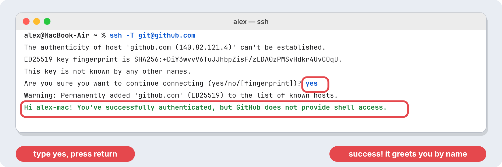

If it says `Permission denied (publickey)`, the key wasn't added correctly: repeat 3.5.

### 3.7 Clone (download) Iki

We'll put the project in your Home folder. (Avoid the Desktop and Documents folders: if iCloud syncs them, it struggles with the thousands of files the build creates.)

```bash
cd ~
git clone git@github.com:pinting/iki.git
```

You'll see `Cloning into 'iki'...` and a few progress lines. Now step into the project and look around:

```bash
cd ~/iki
ls
```

You should see `Cargo.toml`, `README.md`, `crates`, `docs` and a few more. In Finder, the new **iki** folder is in your Home folder (in Finder press **⇧ Shift + ⌘ Command + H** to jump there).

**Errors?**

- `Repository not found`: your invitation isn't accepted yet (3.3), or the SSH key belongs to a different GitHub account.
- `Permission denied (publickey)`: redo 3.5 and 3.6.
- `destination path 'iki' already exists`: you already cloned it. Just run `cd ~/iki`.

## Part 4: Install Rust

Iki is written in the **Rust** programming language. Installing Rust gives you `cargo`, the tool that builds and runs the app. It takes about 5 minutes. (Part 3.1 must be done first: Rust uses Apple's tools.)

1. Open the Terminal.
2. Paste this line and press Return:

```bash
curl --proto '=https' --tlsv1.2 -sSf https://sh.rustup.rs | sh
```

3. It prints *Welcome to Rust!* and a menu with three options. Just press **Return** to choose **1) Proceed with standard installation**.

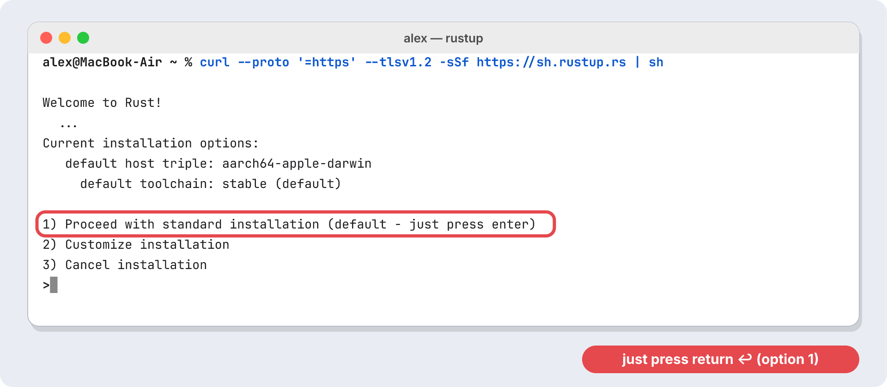

4. Wait while it downloads. At the end it says **Rust is installed now. Great!**
5. **Quit the Terminal (⌘ Command + Q) and open it again.** The Terminal only notices Rust after a restart.

**Check it worked.** Run:

```bash
cargo --version
```

You should see a line like `cargo 1.95.0 (…)`. Any number is fine. If it says `command not found: cargo`, quit the Terminal completely (⌘Q) and open it again.

## Part 5: Build and run Iki

One command turns the code into a working app and opens it: `cargo run`. The first time takes 2 to 10 minutes; after that it starts in seconds.

**Checklist before you start.** Each of these should already work:

- [ ] `git --version` prints a version (Part 3)
- [ ] the `iki` folder exists in your Home folder (Part 3)
- [ ] `cargo --version` prints a version (Part 4)

### 5.1 Go to the project folder

Open the Terminal **in the iki folder** (Part 1.2), or open the Terminal normally and type:

```bash
cd ~/iki
```

The prompt must now end in `iki %`, like `alex@MacBook-Air iki %`. If it doesn't, `cargo` won't find the project and says `could not find Cargo.toml`.

### 5.2 Build and run

```bash
cargo run
```

`cargo` is Rust's helper tool; `run` means "build the app, then start it".

### 5.3 What you will see (and how long to wait)

The first run does three things, and you'll see green words scroll by:

1. **Downloading**: fetches about 300 small building blocks ("crates") the app uses. Needs internet. About 1 minute.
2. **Compiling**: turns all the code into an app. This is the slow part: 2 to 10 minutes depending on your Mac. The fan may spin up. That's normal.
3. **Finished** … **Running** `target/debug/iki`: the build is done and the Iki window opens. If you don't see it, it may be behind the Terminal: press **⌘ Command + Tab** to switch to it.

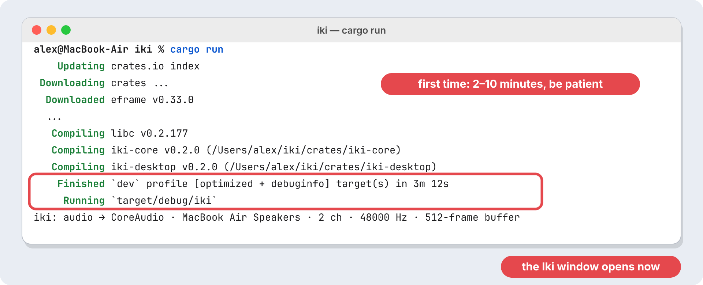

Don't close the Terminal or press anything while it works. Yellow `warning:` lines are fine. Only red `error:` lines mean something went wrong: see Troubleshooting below, or paste the error into your AI helper (Part 2).

### 5.4 Next time

Every time you want to play, it's the same two commands. Now it starts in a few seconds because the finished build is saved in the `target` folder:

```bash
cd ~/iki
cargo run
```

**Getting the newest version.** When the owner says "I pushed changes", run `git pull` first; `cargo run` then rebuilds only what changed (usually under a minute):

```bash
cd ~/iki
git pull
cargo run
```

**Starting completely fresh.** If a build ever gets into a strange state, delete the saved build with `cargo clean` and build again. This takes as long as the very first time:

```bash
cd ~/iki
cargo clean
cargo run
```

## Troubleshooting

Find the message you see in the left column. If yours isn't here, paste it into your AI helper (Part 2).

| You see… | What it means | Fix |
| --- | --- | --- |
| `command not found: cargo` (or `git`, `claude`, `grok`, `agy`) | The Terminal doesn't know about a tool you just installed | Quit the Terminal (⌘Q) and open it again |
| `could not find Cargo.toml in /Users/…` | You're not in the iki folder | `cd ~/iki`, then try again |
| `xcrun: error: invalid active developer path` or `linker cc not found` | Apple's Command Line Tools are missing (often after a macOS update) | Run `xcode-select --install` and click **Install** (3.1) |
| `Permission denied (publickey)` | GitHub doesn't know your SSH key | Redo 3.5 and test with 3.6 |
| `Repository not found` when cloning | No access to the private project yet | Accept the GitHub invitation (3.3) |
| `failed to download` / `network failure` during `cargo run` | Internet hiccup while downloading | Check Wi-Fi and run `cargo run` again; it continues where it stopped |
| The build finished but no window | The window opened behind the Terminal | Press ⌘ + Tab or look for a new Dock icon |
| Nothing happens when typing your password | Normal: macOS hides it | Type it anyway and press Return |
| The Terminal seems frozen | A command is still running | Wait for the `%` prompt; to stop it, press **Control + C** |

## Cheat sheet

One-time setup, in order:

```bash
xcode-select --install                          # Apple tools + Git (click Install)
git config --global user.name "Your Name"
git config --global user.email "you@example.com"
ssh-keygen -t ed25519 -C "you@example.com"      # press Return 3 times
pbcopy < ~/.ssh/id_ed25519.pub                  # then paste at github.com/settings/ssh/new
ssh -T git@github.com                           # type yes
cd ~ && git clone git@github.com:pinting/iki.git
curl --proto '=https' --tlsv1.2 -sSf https://sh.rustup.rs | sh   # press Return
# quit and reopen the Terminal
```

Every time you want to play:

```bash
cd ~/iki
git pull     # optional: get the newest version
cargo run    # build (if needed) and open Iki
```

AI helpers (run inside `~/iki`):

```bash
claude   # Claude Code
grok     # Grok Build
agy      # Antigravity CLI
```

## Sources

The pictures are illustrations made for this guide; your screens may look slightly different.

- [Claude Code setup](https://code.claude.com/docs/en/setup)
- [Grok Build overview (xAI)](https://docs.x.ai/build/overview) and [Grok Build on GitHub](https://github.com/xai-org/grok-build)
- [Antigravity CLI getting started](https://antigravity.google/docs/getting-started?tab=cli)
- [GitHub: Connecting with SSH](https://docs.github.com/en/authentication/connecting-to-github-with-ssh) · [Install Rust](https://www.rust-lang.org/tools/install)
- [README.md](README.md) in this project: build instructions for every platform
