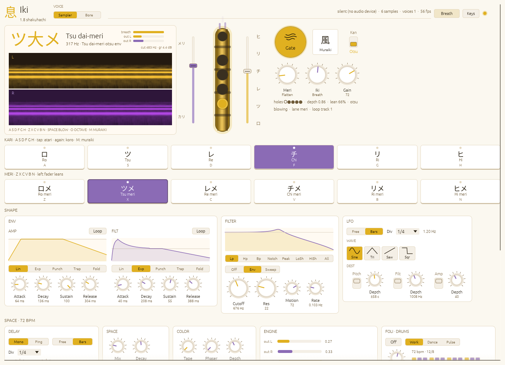
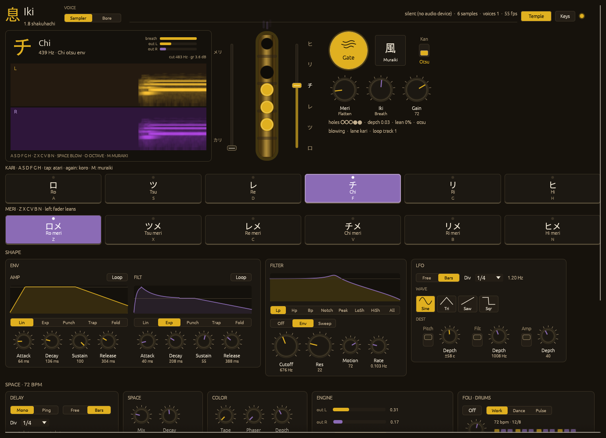

# Iki — 1.8 shakuhachi

A playable shakuhachi (Japanese bamboo flute) synthesizer, written in Rust. It
runs as a desktop app (Linux, macOS, Windows), an Android app, and a VST3 /
CLAP instrument plugin for DAWs such as Ableton Live.

| Breath (day) | Temple (night) |
| --- | --- |
|  |  |

**New to the command line and on a Mac?** Follow the step-by-step
[MAC.md](MAC.md) guide instead: it starts from opening the Terminal.

See [MANUAL.md](MANUAL.md) for playing, MIDI and presets, [CHANGELOG.md](CHANGELOG.md)
for what's new and [RELEASE.md](RELEASE.md) before shipping.

## Prebuilt binaries

Every push is built by GitHub Actions (`.github/workflows/build.yml`). Open
the repository's **Actions** tab, pick a run, and download from
**Artifacts**:

* `iki-linux-x86_64`: the `iki` binary (needs ALSA, X11 or Wayland, OpenGL 2+)
* `iki-macos-universal`: `Iki.app` for Apple Silicon and Intel, macOS 13+;
  see [First launch](#first-launch)

Artifacts are kept for 14 days.

## Requirements

All platforms need **Rust 1.91 or newer**, installed with
[rustup](https://rustup.rs):

```bash
curl --proto '=https' --tlsv1.2 -sSf https://sh.rustup.rs | sh
```

| Platform | Also needed |
| --- | --- |
| Linux | ALSA headers (`alsa-lib` on Arch, `libasound2-dev` on Debian/Ubuntu); at runtime X11 or Wayland and OpenGL 2+ |
| macOS | Apple's command line tools: `xcode-select --install` |
| Windows | Visual Studio C++ Build Tools (rustup offers to install them) |

## Desktop app (Linux, macOS, Windows)

From the repository root:

```bash
cargo run --release
```

The first build takes a few minutes; later runs start in seconds. The binary
is self-contained (the note recordings and font are embedded), so
`target/release/iki` can be copied anywhere.

Useful options (everything after `--` goes to Iki):

| Command | What it does |
| --- | --- |
| `cargo run --release -- --list-devices` | list audio hosts and output devices (`*` = default) |
| `cargo run --release -- --host alsa --device pipewire` | pick an output explicitly (part of the name is enough) |
| `cargo run --release -- --buffer 1024` | larger audio buffer, if you hear crackles |
| `cargo run --release -- --silent` | run without an audio device |
| `cargo run --release -- --night` | start in the Temple theme (`--day` for Breath) |
| `cargo run --release -- render out.wav` | render a demo phrase to a WAV file |
| `cargo test --release` | run the unit and end-to-end audio tests |

On Linux with PipeWire, install `pipewire-pulse` (or `pipewire-alsa`) if there
is no sound.

## macOS app (Iki.app)

`Iki.app` is one universal app for Apple Silicon and Intel Macs, macOS 13
Ventura or newer.

### Cross-build from Linux

```bash
cargo install cargo-zigbuild --locked
cargo install apple-codesign --locked --bin rcodesign   # ad-hoc signing
# plus zig 0.13+ (pacman -S zig) and zip
scripts/build-macos.sh
```

Output: `dist/Iki.app` and `dist/Iki-macos-universal.zip`. The first run
downloads the macOS SDK once into `~/.cache/iki/` (about 90 MB; set
`MACOS_SDK_DIR` to use your own).

### Build on a Mac

```bash
cargo build --release
mkdir -p Iki.app/Contents/MacOS Iki.app/Contents/Resources
cp target/release/iki Iki.app/Contents/MacOS/iki
cp packaging/macos/Iki.icns Iki.app/Contents/Resources/
VERSION="$(sed -n 's/^version = "\(.*\)"/\1/p' Cargo.toml | head -1)"
sed "s/@VERSION@/$VERSION/g" packaging/macos/Info.plist > Iki.app/Contents/Info.plist
codesign --force --deep --sign - Iki.app
```

This builds for the Mac's own architecture only; use the cross-build above for
a universal app.

### First launch

The app is ad-hoc signed but not notarized, so macOS blocks the first launch
of a downloaded copy:

* **macOS 15 Sequoia and newer:** double-click Iki, click **Done**, then open
  **System Settings → Privacy & Security**, click **Open Anyway** and confirm.
* **macOS 13 / 14:** right-click Iki → **Open** → **Open**.
* **Any version**, from the Terminal:

  ```bash
  xattr -dr com.apple.quarantine /Applications/Iki.app
  ```

If macOS says *"Iki is damaged and can't be opened"*, re-sign it locally:

```bash
xattr -cr /Applications/Iki.app
codesign --force --deep --sign - /Applications/Iki.app
```

To pass options: `open -a Iki --args --night`, or run
`/Applications/Iki.app/Contents/MacOS/iki --list-devices` to see diagnostics.

## Instrument plugin (VST3 / CLAP)

The same instrument as a plugin: **VST3** for Ableton Live, Cubase, FL Studio,
Studio One…, and **CLAP** for Bitwig, Reaper…

### Build (cross-compiled from Linux)

```bash
cargo install cargo-zigbuild --locked
cargo install apple-codesign --locked --bin rcodesign   # only for macOS
# plus zig 0.16+ and zip
scripts/build-plugin.sh             # all: windows, macos, linux
scripts/build-plugin.sh macos       # or just some of them
```

Output: `dist/Iki-plugin-windows.zip` (x64), `dist/Iki-plugin-macos.zip`
(universal, macOS 11+) and `dist/Iki-plugin-linux.tar.gz`. Each holds
`Iki.vst3` and `Iki.clap`.

### Install

**Windows:** copy `Iki.vst3` to `C:\Program Files\Common Files\VST3\` and
`Iki.clap` to `C:\Program Files\Common Files\CLAP\`.

**macOS:** copy `Iki.vst3` to `~/Library/Audio/Plug-Ins/VST3/` and `Iki.clap`
to `~/Library/Audio/Plug-Ins/CLAP/`, then clear the download quarantine once:

```bash
xattr -dr com.apple.quarantine ~/Library/Audio/Plug-Ins/VST3/Iki.vst3
xattr -dr com.apple.quarantine ~/Library/Audio/Plug-Ins/CLAP/Iki.clap
```

**Ableton Live:** *Settings → Plug-Ins*, turn on **Use VST3 Plug-In System
Folders** and press **Rescan**. Then drop **Iki** (under *Plug-Ins*) on a MIDI
track.

## iPhone app

See [IOS.md](IOS.md) (iPhone 7 / iOS 15+, needs a Mac with Xcode).

## Android app

Needs the Android SDK (platform 36, build-tools, NDK r30) in `$ANDROID_HOME`
or `~/Android/Sdk`, JDK 21, and `cargo install cargo-ndk --locked`.

```bash
scripts/build-android.sh                 # builds, runs the tests, then the APK
SKIP_TESTS=1 scripts/build-android.sh    # skip the tests
adb install -r dist/iki-android.apk      # install on a connected phone
```

Output: `dist/iki-android.apk` (arm64, armv7, x86_64; Android 8+).

## License

Proprietary. Copyright (c) 2026 Mihai Vasiu and Denes Tornyi, all rights
reserved; see [LICENSE](LICENSE). The plugin binaries are GPLv3, because the
VST3 bindings of [nih-plug](https://github.com/robbert-vdh/nih-plug) are. Fonts: Noto Sans JP
subset, SIL Open Font License
(`crates/iki-ui/assets/fonts/OFL-NotoSansJP.txt`).
